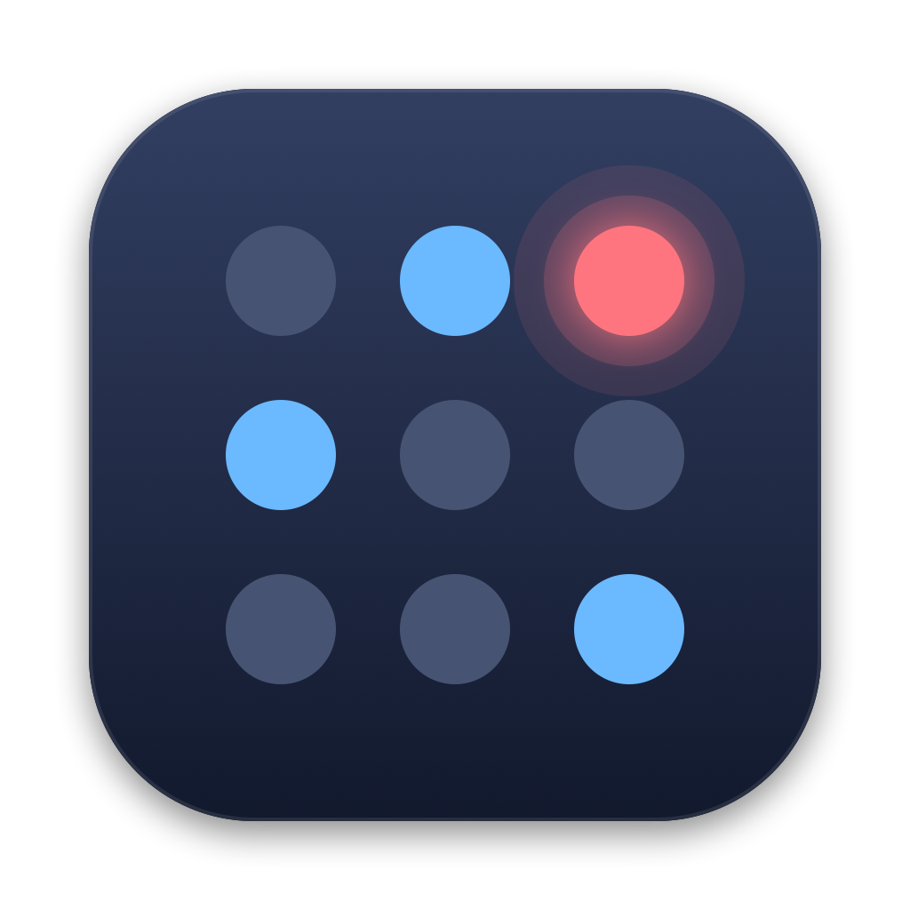
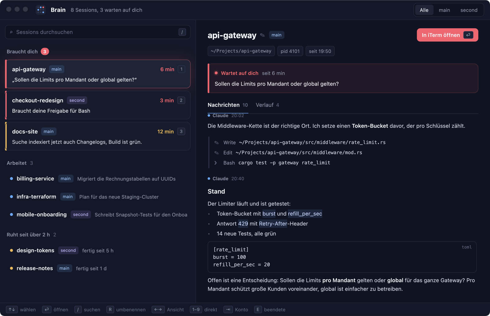

<p align="center"></p>

# Brain

A native macOS window for everyone running many [Claude Code](https://claude.com/claude-code)
sessions at once. Brain shows every session across all your Claude accounts, what each one
is doing, and above all **which ones are waiting for you**. Answer them right there, or jump
to the session's terminal with one key.

https://github.com/user-attachments/assets/dc7c6023-01a2-48a5-aaae-39ee590d54b0

*A three-minute tour of version 0.1 (German interface), narrated. Brain runs on made-up demo
sessions here.*



Built in Rust with [Iced](https://iced.rs) (native text input with dead keys and input methods,
undo, selection) and AppKit for the menu bar item, notifications and `brain://` links. The
interface follows your macOS language: English or German.

A short guide with every feature, in German: [docs/anleitung.md](docs/anleitung.md).

## What it does

- **Sessions run in Brain.** `⌘N` starts a session as a Claude Code background session
  (`claude --bg`) and opens it in Brain's own terminal: Claude Code exactly as in your terminal,
  in your iTerm2 font and colours, at a readable width. It keeps running when Brain quits, and
  `claude attach <id>` opens it from any terminal. `I` moves a session from an iTerm tab into
  Brain without losing its conversation (`/exit` there, `claude --bg --resume` here).
- **Screenshots and files in.** Drag files onto the terminal or paste a copied screenshot with
  `⌘V`: Brain inserts the path, and Claude reads the picture. `⌘`-click a path or URL in the
  output: Markdown opens in [YAMV](https://github.com/martinemmert/yet-another-markdown-viewer)
  (math, Mermaid, extended Markdown; the text editor if YAMV isn't installed), other files in a
  reader beside the terminal (code highlighted, images shown; `⌘⏎` opens it in your editor),
  URLs in the browser.
- **The terminal, made for sessions.** Multi-line pastes arrive as one paste, dead keys and
  dictation work, the title Claude Code sets shows beside the session, and a bell from a session
  you're not looking at marks it. `⌘D` (on the Terminal tab) keeps one terminal on screen beside
  the next session you pick; `⌘⇧A` shows every session that runs in Brain as a live preview.
- **Quick terminal.** A key you pick, e.g. `"quick_terminal": "cmd+shift+b"` in
  `~/.claude-brain/config.json`, brings Brain forward from any app with the longest-waiting
  session's terminal; again hides Brain. Off until set: a global key takes the combination
  everywhere, also from macOS (⌃⌥Space switches the input source).
- **Command palette.** `⌘K`: every action, `/compact`, `/context`, `/model` and other slash
  commands for the session, and any text sent to it or to every session whose turn it is.
- **Files.** Every file a session wrote, edited, read or was given, newest first: find the
  Markdown files it created. A click opens one. The last segment, *Git changes*, shows the
  folder's branch, ahead/behind and changed files; a click shows a diff, "Discard change" (twice)
  puts the current version in the Trash and restores HEAD's.
- **Konsil.** A council of the konsil skill (the lazy senior against his buddy) as a stage: both
  figures, where they agree and where they still fight, every round in full. The skill marks it
  with `brain konsil start|stand|end`; the Konsil tab shows once a session held one.
- **Composer.** `⌘E`: a large editor for a longer prompt, with your templates, dictation and
  screenshots pasted with `⌘V`; `⌘⏎` sends it as one paste.
- **Screenshots, offered.** A new screenshot shows above the footer: into the waiting session's
  terminal or into the composer. `"screenshot_folder"` in the config changes the folder
  (`"off"` turns it off).
- **Reply from the notification.** "Session waits" notifications have a reply field (only on an
  unlocked Mac); the text goes into the session.
- **Shell per project.** `⌘T` opens a login shell in the session's folder below its terminal.
- **Context gauge.** From 80 % context the gauge turns amber and offers `/compact`.
- **Before resuming.** An ended session's Terminal tab sums it up: how it began, what was asked
  last, the last answer, an open question, the files it changed.
- **Usage forecast.** "full ~Thu 14:00" when a limit would run out at this pace, and which
  account has room. The weekly limit goes by the last 24 hours (its state is kept every ten
  minutes in `~/.claude-brain/usage-history/`), the five-hour one by its window so far.
- **Find in the whole session.** `⌘F` opens the find bar over the conversation; its lenses show
  the conversation, only your prompts, Claude's questions with your answers (unanswered ones
  stand out), or the session's events (every hook event and report). `esc` closes it. `⌘⇧C`
  copies Claude's last answer; ⌘K → *Open the conversation as Markdown* opens it in YAMV.

- **Triage inbox.** Sessions that wait for you come first, longest wait on top: red when
  Claude asks a question or needs a permission, amber when a turn finished, quiet blue when the
  turn ended but subagents or background shells still run (from the Stop hook's
  `background_tasks`; Claude's own `brain report --waiting` still marks it red).
- **Answer from Brain.** Allow or deny an open permission prompt (`Y` / `N`), or reply to a
  session that waits for you (`T`; the Reply button is the waiting card's primary action). Brain
  only types when the session's state is unambiguous.
- **All accounts in one place.** `~/.claude`, `~/.claude-second` and any other
  `~/.claude-*` config dir (as used with `CLAUDE_CONFIG_DIR`) are picked up automatically.
- **Latest messages.** Your prompts, Claude's replies rendered as Markdown, tool calls as
  one-line summaries, read live from the session transcript.
- **Session details.** One line under the name: folder, model, context fill, permission mode,
  days left to resume, the PR; Claude Code's cost total, pid and start time on hover.
- **Plan usage.** Five-hour and weekly limits per account with their reset times, from the
  status line (Brain wraps your status line command and passes its output through unchanged).
- **Pull requests.** The PR of each session's branch with its checks (`#12 ✓`, `#12 ✗`, `#12 …`),
  via the GitHub CLI (`gh`, logged in); click it to open the PR.
- **Conflicts.** A warning (and one notification) when two sessions edit the same files, read
  from their transcripts, and a softer hint when they change files in the same checkout.
- **Today** (`D` or ⌘K; `esc` leaves). What every session reported as done today, per project;
  `⌘C` copies it as Markdown.
- **The conversation reads like the terminal:** your prompts as `> …`, Claude's replies and tool
  calls with `●`, in your terminal's font (iTerm2's default profile, e.g. JetBrains Mono 13).
  `"chat_font"` and `"chat_font_size"` in `~/.claude-brain/config.json` pick another one.
- **Keep the list short, lose nothing.** Sessions that never got a prompt don't show up.
  Everything that isn't asking for you is a folded section at the end of the list, each with its
  count: *Resting for over 2 h*, *Snoozed and hidden*, *Quiet in the background*, *Started by
  programs* (security reviews, SDK scripts, `claude -p`) and *Ended* (the last day; older ones
  through the search). A click, or ⌘K, opens one. `⌘⌫` twice moves an ended session's transcript
  to the **Trash**. `C` opens *Clean up*: everything ended (or in the background) and quiet for
  1, 3, 7 or 14 days, to hide or trash at once. Pinned and saved sessions always stay.
- **Claude Code's background sessions** (`claude --bg`, listed by `claude agents`) show with
  their own state (blocked, failed, done …) while something happens; after a day without activity
  they go to *Quiet in the background*, and like those programs started, they never notify. `⏎`
  attaches to one, `X X` stops it, `⌘⌫ ⌘⌫` stops it, moves its transcript to the Trash and runs
  `claude rm`.
- **End now, resume later.** `X` twice ends a waiting session (`/exit`); closing the tab works
  too. Ended sessions stay in the list as long as Claude Code keeps their transcript
  (`cleanupPeriodDays`, 30 days by default), with their name, last message and how many days are
  left. `P` saves one under "Saved to resume" at the top; `⏎` resumes it in a new tab.
- **Open the terminal.** iTerm2, Terminal.app and tmux (in any terminal) jump to the exact
  pane; VS Code and Cursor bring the project window forward.
- **Search** by name, path, account or last message; **group by project** (`G`, or *Projects*
  next to the search field; git worktrees count as their main repository); **pin** and **mute**
  (right-click or ⌘K) sessions. The title bar keeps the account filter (`⇥`) and alerts.
- **Rename** a waiting session; Brain types `/rename <name>` into its terminal.
- **Menu bar count** and native **notifications** with *Open* and *Snooze 15 min*, sound only
  when a session calls you; reminders while a session keeps waiting (`remind_after_minutes`
  in `config.json`, 10 by default, 0 turns them off). `S` snoozes a session: 15 min → 1 h →
  tomorrow 9:00 → until something happens in it → back (`⌫` twice jumps to the last).
- **New sessions** in a recent folder and any account (`⌘N`), or from a **template**: a
  Markdown file with folder, account, model and a first prompt with placeholders (below).
- **Go on … (`A`)**: one dialog for where and how a session goes on. Pick the account (`1`,
  `2`, …, each with its current usage), whether the original keeps running (`⇥`), and flags
  such as `--chrome` or `--model opus`; the dialog says what ⏎ will do:
  - **another account, the original ends:** a *move*, e.g. when one hits its five-hour limit.
    Brain copies the transcript, resumes it there with `claude --resume <id> --fork-session`
    and closes the original;
  - **the original keeps running:** a *fork* (`F` opens the dialog so) into any account, its own
    too, as a background session attached in Brain;
  - **its own account with flags:** a *restart* (right-click or ⌘K → *Restart with …*): Claude
    takes flags only at start, so the session ends and goes on where it ran (in the background,
    in Brain's terminal, or in a new iTerm tab);
  - **its own account without flags:** a session in iTerm moves into Brain (`I`).

  ⌘K also lists *Continue in <account>* and *Fork into <account>* to do it in one step.
- **Quick replies.** `T`, then `1`–`9` fills in a canned reply and ⏎ sends it (a digit alone
  never sends: Claude's numbered questions); set your own with `"quick_replies": ["…", "…"]` in
  `~/.claude-brain/config.json`.
- **Keys at hand.** The footer shows the keys for the selected session's state; `?` lists them
  all.
- **The gardener** (⌘K, or the title bar's `✂ N broken`, or `brain garden`) finds sessions Brain
  lists but can't steer any more and ends them for good: one that runs twice (a moved
  conversation whose original kept running), one whose terminal closed right after attaching,
  and, only as a guess and not preselected, one "working" for 3 hours without a sign of life.
  Ending tries `claude stop`, then SIGTERM, then SIGKILL, and only on a process that still runs
  Claude Code; the conversation stays resumable. Right-click → *End by force* does it for one
  session that won't end. `brain garden --yes` ends the sure ones from the terminal.
- **A log** of everything Brain said in its status line, what failed, what a session's terminal
  showed when it closed, the gardener's work and the account sync at session starts:
  `~/.claude-brain/logs/<date>.log`, kept two weeks (⌘K → *Open the log*).
- **English or German**, following your macOS language (override with `BRAIN_LANG=de|en` or
  `{"language": "de"}` in `~/.claude-brain/config.json`).

## How sessions report

Every session appends JSON lines to `~/.claude-brain/events/YYYY-MM-DD.jsonl`, from two
sources:

- **Hooks** (automatic): `SessionStart`, `UserPromptSubmit`, `Notification`, `Stop` and
  `SessionEnd` call `brain hook`.
- **Reports** (written by Claude, instructed via `CLAUDE.md`):
  `brain report --doing|--waiting|--done "<one line>"`.

Without hooks Brain still shows a coarse state from Claude Code's own
`<config>/sessions/<pid>.json` files.

## The Brain mod

Claude Code [mods](https://code.claude.com/docs/en/plugins/mods/overview) run inside Claude
Code (v2.1.287 or later). Brain's mod (`mod/brain`, built into the `brain` CLI) reports each
session from there: start, prompts, questions (AskUserQuestion) and permission requests, turn ends
with the subagents still running, the end, and after every turn the context fill and plan limits
— what the status line wrapper recorded. `brain install` writes it to `~/.claude-brain/mod/brain`
and lists that folder in `env.CLAUDE_CODE_PLUGIN_DIRS` of every account's `settings.json`;
`brain uninstall` removes it. The settings hooks stay for now as a fallback: once a session
reports through the mod, Brain leaves out its hook events.

## A new Claude account

`brain account new <name>` (or ⌘K → *Set up a new Claude account*) makes `~/.claude-<name>` from
the existing accounts: `settings.json` merged (lists joined, main's values win), `CLAUDE.md`,
the status line script, skills, agents, commands, output styles, plugins and marketplaces (paths
rewritten, files cloned on APFS), user MCP servers, and every project's memory notes (the newer
note wins, `MEMORY.md` joined). Without `--yes` it only shows the plan and the differences. No
login and no conversations come along: log in with `/login` in the first session. Brain's hooks
are installed into it right away.

## Keeping the accounts in step

⌘K → *Sync accounts* (or `brain sync`, `--yes` to write) brings the accounts' setup together:
`settings.json`, `CLAUDE.md`, the status line script, `keybindings.json`, skills, agents,
commands, output styles, user MCP servers and every project's memory notes. Not the login,
conversations, the plugins' files, or `skills/synced` (claude.ai's own, per Claude account).

- After each sync Brain keeps the state the accounts agreed on (`~/.claude-brain/sync/base.json`).
  Next time each item (a setting, an entry of a list such as an allowed command, a skill, a note)
  is compared with it: what one account changed or deleted since goes to the others.
- Where accounts changed an item differently, that's a conflict: the dialog shows each account's
  version and suggests the newest change; `1`–`9` picks another, `K` lets the accounts with
  another version keep theirs from now on (`~/.claude-brain/sync/keep.json`). Memory notes never
  wait: the newer one wins, `MEMORY.md` is joined line by line.
- The first sync joins the accounts (nothing is known to be deleted yet). After it, **every
  session start syncs** too (`brain hook` at `SessionStart`), but leaves conflicts and anything
  that grants rights or can run code (permissions, hooks, `env`, the status line and its script,
  helpers, plugins, MCP servers, skills, commands, agents; marked ⚑) for the dialog; the title
  bar counts them (`⇄ 2 account conflicts`). Plain settings, `CLAUDE.md`, output styles and
  memory sync on their own.
- An account the last sync didn't know, or one without the file or folder at all, only receives:
  what it lacks is missing, not deleted. A broken `settings.json` is left alone.
- What a sync replaces or deletes is kept in `~/.claude-brain/sync/backup/<time>/` for 30 days.

## Brain Link (the iPhone companion)

**Brain Companion** (repo `brain-companion-native`, SwiftUI; before that `brain-companion`, .NET
MAUI) shows the sessions on the iPhone, reads along, replies, answers permission dialogs and
moves a session to another account; Brain carries those out on the Mac as it does for a reply
typed in Brain (a move as with `A`). ⌘K → *Pair a phone (Brain Link)* turns the server on and
shows a QR code; the iPhone camera opens it in the app.

- Off until paired, then it starts with Brain. HTTPS on port 48620 on every interface, so the
  phone reaches it while both are in the same Wi-Fi. The pairing offers the Mac's Bonjour name
  and its Wi-Fi/Ethernet addresses (no VM bridges or VPN tunnels); `/v1/hello` tells the phone
  the current ones, so a new address needs no new pairing.
- The code carries the Mac's addresses, a random token (required on every request, compared in
  constant time) and the SHA-256 of Brain's self-signed certificate, which the app pins.
- Certificate, key and token live in `~/.claude-brain/link` (0700). *Sign out all phones* makes a
  new token; *Turn Brain Link off* closes the server.
- A permission answer carries when the dialog it answers opened; Brain sends it only while that
  same dialog is open.
- The phone sees what a session changed in its folder (git status, each file's diff) and opens
  the files the session wrote, edited or read; nothing else on the disk.
- Photos and PDFs from the phone land in `~/.claude-brain/link/inbox/<session>/` (0600); the
  reply names their paths, so Claude reads them.

## Install

Requirements: macOS 13+ (Apple Silicon for the release builds).

### With Homebrew

```sh
brew tap martinemmert/big-brain-claude https://github.com/martinemmert/big-brain-claude
brew install --cask brain
brain install
```

The cask installs `Brain.app` and links the `brain` CLI that ships inside it. The app is
only ad-hoc signed, not notarized, so macOS blocks the first start: System Settings →
Privacy & Security → Open Anyway, or `xattr -dr com.apple.quarantine /Applications/Brain.app`.
`brain install` (once) adds the hooks, see [From source](#from-source).

### From a release

Download `Brain-<version>-macos-arm64.zip` and `brain-<version>-macos-arm64.tar.gz`
(Apple Silicon) from [Releases](https://github.com/martinemmert/big-brain-claude/releases).

1. Unzip and move `Brain.app` to `/Applications`. The app is only ad-hoc signed, not
   notarized, so macOS blocks the first start: right-click → Open (macOS 15: System
   Settings → Privacy & Security → Open Anyway), or run
   `xattr -dr com.apple.quarantine /Applications/Brain.app`.
2. Put `brain` on your `PATH` and run `brain install`. The hooks call `brain` at the path it
   was installed from, so move it first:

   ```sh
   tar -xzf brain-*-macos-arm64.tar.gz
   sudo mv brain /usr/local/bin/   # or any other directory on your PATH
   brain install
   ```

   If macOS refuses to run it, `xattr -d com.apple.quarantine /usr/local/bin/brain`.

### From source

Requires a recent stable Rust toolchain.

```sh
git clone https://github.com/martinemmert/big-brain-claude.git
cd big-brain-claude
./scripts/install.sh
```

This

- builds `dist/Brain.app` and `dist/brain` with `scripts/bundle.sh`,
- installs the `brain` CLI to `~/.cargo/bin`,
- installs `~/Applications/Brain.app` (open it via Spotlight),
- runs `brain install`, which adds Brain's hooks, a `Bash(brain report:*)` permission and a
  short protocol section to the `settings.json` and `CLAUDE.md` of every `~/.claude*`
  account. Existing files are backed up as `*.brain-backup-<timestamp>`; running it again
  is safe.

Running sessions pick up the hooks on their own.

### Alfred

Download `Brain.alfredworkflow` from the
[latest release](https://github.com/martinemmert/big-brain-claude/releases/latest) and
double-click it. Type `cc` and part of a session's name, path or latest message:

- `⏎` brings the session's terminal to the front (`brain open <account>:<pid>`),
- `⌥⏎` shows it in Brain (`brain show <account>:<pid>`).

The workflow finds `brain` in `/opt/homebrew/bin`, `/usr/local/bin` or `~/.cargo/bin`.
Sessions are listed in Brain's order: needs you, your turn, working.

## Uninstall

```sh
brain uninstall
```

This removes Brain's hooks, the `Bash(brain report:*)` rule and the protocol section from
the `settings.json` and `CLAUDE.md` of every `~/.claude*` account, with backups as above.
Then delete `Brain.app`, the `brain` binary (`~/.cargo/bin/brain` or wherever you put it)
and `~/.claude-brain`. With Homebrew: `brew uninstall --zap --cask brain` removes all three.

## Keys

| Key | Action |
|---|---|
| `↑` `↓` / `j` `k` | select |
| `1`–`9` | open the n-th session |
| `⏎`, double-click | open the session: in Brain's terminal if it runs in Brain, else its terminal app (an ended one resumes) |
| `⌥⏎` | open it in iTerm instead |
| `⌘J` `⌘2` / `⌘[` `⌘1` | keyboard into the terminal / back to the list |
| `/` | search the session list (`esc` clears) |
| `⇥` / `⇧⇥` | cycle the account filter |
| `G` / `D` | group by project / today's digest (`⌘C` copies it, `esc` leaves) |
| `C` | clean up: hide or trash everything quiet for N days |
| `⌘N` | start a new session (in Brain; `⌘I` in the dialog: in iTerm) |
| `T` | reply to a session that waits for you (`1`–`9` fills in a quick reply, `⏎` sends) |
| `Y` / `N` | allow / deny an open permission prompt |
| `R`, click the name | rename (while the session waits for you) |
| `P` | pin (an ended session: save it to resume) |
| `S` | snooze: 15 min → 1 h → until tomorrow 9:00 → until something happens → back |
| `⌫` `⌫` | straight to "until something happens" (hidden; again: show it) |
| `A` | go on …: another account, a fork or flags (one dialog) |
| `F` | the same dialog, set for a fork (the original keeps running) |
| `I` | the same dialog, set for moving a session from iTerm into Brain |
| `X` `X` | end the session (`/exit`; a background session: `claude stop`); it stays resumable |
| `⌘⌫` `⌘⌫` | move an ended session's transcript to the Trash |
| `⌘F` | find in the session's whole conversation; lenses: prompts, questions, events (`esc` closes) |
| `⌘⇧C` | copy Claude's last answer |
| `⌘E` | composer: a longer prompt for the session (`⌘⏎` sends) |
| `⌘T` | shell in the session's folder (again: hide) |
| `⌘D` | on the Terminal tab: keep this terminal beside the next session (again: end) |
| `⌘⇧A` | all terminals as live previews |
| `⌘`-click | open a path (Markdown in YAMV, else the reader) or URL from the terminal output |
| `⌘V` | paste a copied screenshot into the terminal |
| `←` `→` | switch tabs: messages, files, (Konsil,) terminal |
| `⌘K` | command palette: everything, also what has no key (mute, open/fold sections, sync accounts …) |
| `?` | every key |
| `esc` | close a dialog, the find bar or Today; clear the search |
| your `quick_terminal` key | from any app: Brain with the waiting session's terminal (again: hide) |
| right-click | a session's actions |

`brain status` prints the board in the terminal; `brain sessions --json` lists the open
sessions for scripts (account, pid, name, phase, headline, cwd).

## Templates

Templates live in `~/.claude-brain/templates/*.md` and are edited in your own editor
(`⌘E` in the `⌘N` dialog opens the selected one, `⌘⇧N` creates a new one):

```markdown
---
name: Review a merge request
folder: ~/Work/app
account: main
model: haiku
---
Review the merge request for {branch} and list blocking issues first.
```

Every header line is optional. Brain asks for each `{placeholder}` and, if the template has no
`folder`, for the folder, then starts `claude --model … '<prompt>'` in a new terminal tab.

## Develop

```sh
cargo test -p brain-core              # protocol, state, transcript and Markdown logic
cargo run -p brain-app                # the app against your real sessions
BRAIN_DEMO=1 cargo run -p brain-app   # made-up sessions, e.g. for screenshots
./scripts/make-icns.sh                # re-render the icon
./scripts/bundle.sh                   # release build into dist/ (ad-hoc signed Brain.app, brain,
                                      # Brain.alfredworkflow)
```

Pushing a `v*` tag that matches the version in `Cargo.toml` builds a GitHub release with
the zipped app, the `brain` binary, the Alfred workflow and SHA-256 checksums, then points
`Casks/brain.rb` at it (a commit to `main`).

- `crates/brain-core`: event protocol, store, accounts, session discovery, state reducer,
  transcript and Markdown readers
- `crates/brain-terminal`: terminal adapters (iTerm2, Terminal.app, tmux, VS Code, Cursor)
- `crates/brain-cli`: the `brain` binary (`hook`, `report`, `install`, `uninstall`, `status`,
  `sessions`, `open`, `show`)
- `crates/brain-app`: the Iced app
- `crates/iced-term`: Brain's fork of [iced_term](https://github.com/Harzu/iced_term) (MIT,
  Ilya Shvyryalkin): Ctrl keys, ⇧⏎ and back-tab for Claude Code, clickable file paths, plain
  look-alikes for glyphs that would fall back to colour emoji

Design notes: [`docs/superpowers/specs/2026-10-02-claude-brain-design.md`](docs/superpowers/specs/2026-10-02-claude-brain-design.md)

## License

[MIT](LICENSE)
